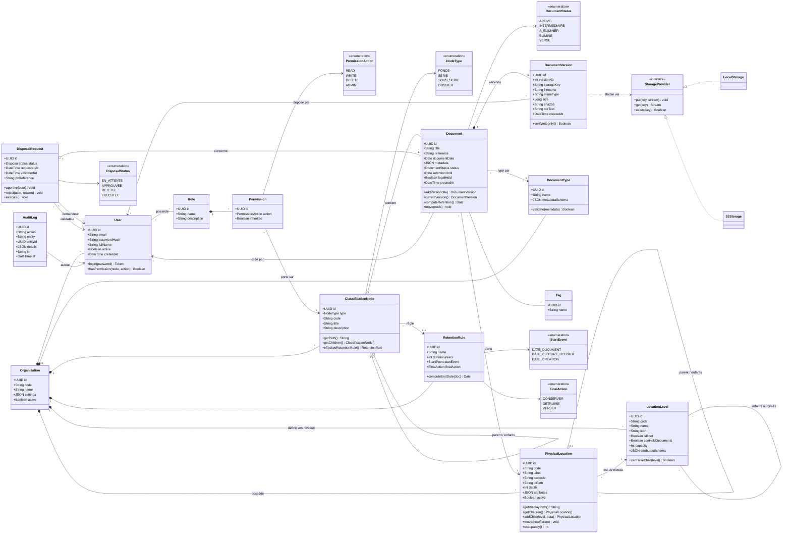

# GED — Diagramme de classes



## Notes de lecture

- **Composition (`*--`)** : une `DocumentVersion` n'existe pas sans son `Document`, une `Permission` pas sans son `Role`.
- **Agrégation (`o--`)** : un nœud du plan de classement contient des documents, mais un document peut être déplacé vers un autre nœud.
- **Auto-association** : `ClassificationNode` et `PhysicalLocation` sont des arbres (relation parent / enfants).
- **Multi-société** : chaque `Organization` a ses propres utilisateurs, plan de classement, types de documents, règles et archives physiques. Toutes les requêtes sont filtrées par société.

## Archives physiques dynamiques

Chaque société dessine son propre arbre en deux étapes :

1. **Elle définit ses niveaux** (`LocationLevel`) et les enfants que chaque niveau accepte :

   ```
   Société A :  Bâtiment → Étage → Salle → Armoire → Étagère → Boîte
   Société B :  Site → Magasin → Travée → Conteneur
   Société C :  Entrepôt → Rack ─┬→ Carton
                                 └→ Classeur → Chemise
   ```

   La relation « enfants autorisés » est de plusieurs vers plusieurs. Un niveau peut donc avoir plusieurs types d'enfants, et l'arbre n'est pas forcément une chaîne fixe.

2. **Elle crée ses emplacements réels** (`PhysicalLocation`) dans cet arbre. Par exemple « Bâtiment Casa » → « Étage 2 » → « Salle 204 » → …

Règles appliquées :
- Un emplacement racine doit appartenir à un niveau marqué `isRoot`.
- Un enfant n'est accepté que si `parent.level.canHaveChild(enfant.level)` le permet.
- Seuls les niveaux `canHoldDocuments` (une boîte, un carton…) peuvent recevoir des documents.
- `attributesSchema` permet d'ajouter des champs libres par niveau (dimensions, température, responsable…). Ils sont stockés dans `attributes` et validés à la saisie.
- `capacity` et `occupancy()` permettent de savoir quand une boîte ou une étagère est pleine.

### Le chemin peut changer

Un chemin change quand on renomme un emplacement (son code ou son libellé) ou quand on le déplace (par exemple une armoire transférée dans une autre salle). La conception en tient compte :

| Élément | Contenu | Stocké ? | Quand il change |
|---|---|---|---|
| `parent_id` | ID du parent | Oui | C'est la **source de vérité** |
| `idPath` | Chemin fait d'**ID** : `/a1f3/9c2e/77b0/` | Oui, index technique | Seulement en cas de **déplacement** |
| `getDisplayPath()` | « Bâtiment Casa › Étage 2 › Salle 204 » | **Non**, calculé à la lecture | Toujours à jour |

- **Renommer** ne touche à rien : les ID ne changent pas, donc `idPath` non plus. Le chemin affiché suit automatiquement.
- **Déplacer** un emplacement met à jour tout son sous-arbre en une seule transaction :
  ```sql
  UPDATE physical_locations
  SET id_path = :newPrefix || substring(id_path from length(:oldPrefix) + 1),
      depth   = depth + :deltaDepth
  WHERE organization_id = :org AND id_path LIKE :oldPrefix || '%';
  ```
  Avant le déplacement, deux vérifications :
  - on ne peut pas déplacer un nœud sous l'un de ses propres descendants ;
  - le niveau du nouveau parent doit accepter le niveau de l'enfant.
- **Les documents** référencent `physical_location_id` et jamais le chemin. Ils suivent donc leur boîte automatiquement.
- **L'historique** est conservé : chaque déplacement écrit dans `AuditLog` l'ancien et le nouveau chemin affiché, figés au moment du changement. On peut ainsi toujours savoir où se trouvait une boîte à une date donnée.
- Le même principe s'applique au plan de classement (`ClassificationNode`).
- **Héritage des règles** : si un nœud n'a pas de `RetentionRule`, `effectiveRetentionRule()` remonte au parent. Les permissions suivent le même principe (`inherited`).
- **`AuditLog`** n'est jamais modifié ni supprimé : on ne fait qu'y ajouter des lignes.
- **`StorageProvider`** est une interface : on passe du disque local à S3/MinIO sans toucher au code métier.
